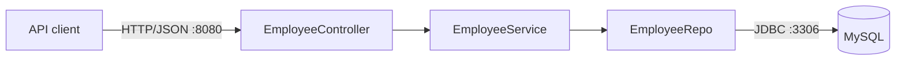
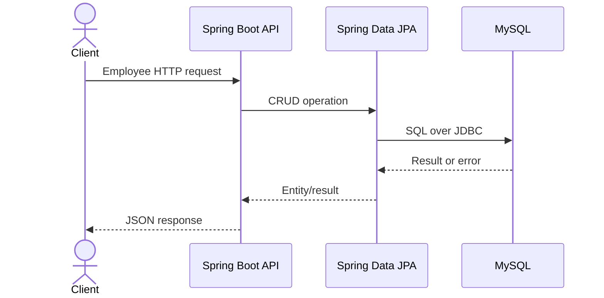
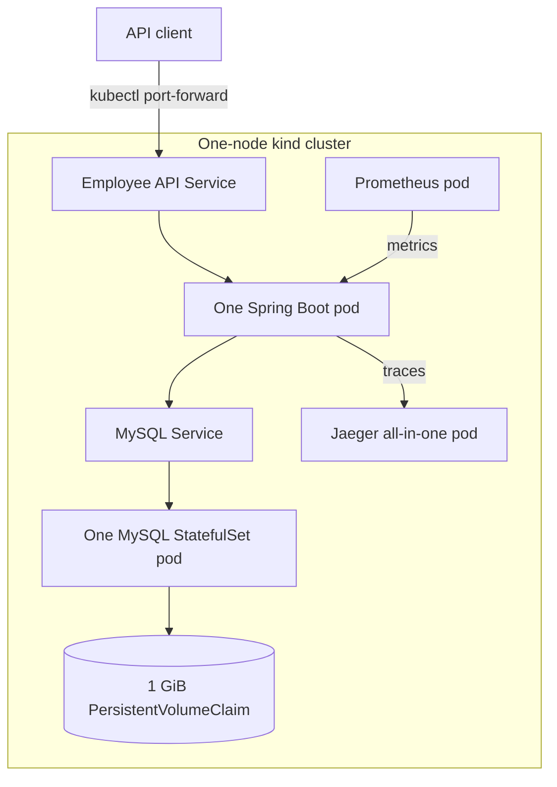
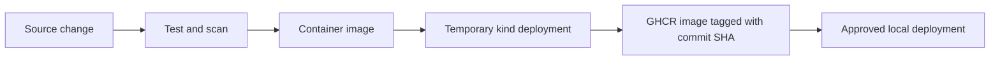
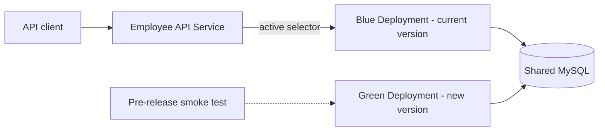

# Employee Management System Architecture

## Scope

This project is designed for a small local workload: two or three users and approximately one or two requests per second. The goal is to demonstrate the required DevOps practices without production-scale or cloud infrastructure.

The application remains a Spring Boot monolith with MySQL as its database. It will run on a one-node local Kubernetes cluster created with `kind`.

## Current application



| Component | Responsibility | Main dependency |
|---|---|---|
| `EmployeeController` | Handles employee HTTP requests and responses | Spring MVC |
| `EmployeeService` | Applies CRUD rules and transaction boundaries | `EmployeeRepo` |
| `EmployeeRepo` | Reads and writes employee entities | Spring Data JPA |
| MySQL | Stores employee data | Persistent disk |
| Maven | Builds and tests the application | Java 17 |

### API endpoints

All endpoints use the `/api/v1/employee` prefix.

| Method | Path | Purpose |
|---|---|---|
| `POST` | `/saveEmployee` | Create an employee |
| `PUT` | `/updateEmployee` | Update an employee |
| `GET` | `/getAllEmployees` | List employees |
| `GET` | `/searchEmployee/{empId}` | Find an employee |
| `DELETE` | `/deleteEmployee/{empId}` | Delete an employee |

## Request path



Requests are synchronous. MySQL latency therefore contributes directly to API latency. The application also needs a working database connection during startup.

## Failure boundaries

| Failure | Effect | Control and evidence |
|---|---|---|
| Invalid request | The API rejects or fails the request | Controller tests and API smoke tests |
| Application process stops | The API is unavailable briefly | Kubernetes restarts the pod; liveness and readiness verify recovery |
| MySQL is unavailable | Startup or CRUD operations fail | MySQL readiness check, application logs, and dependency health evidence |
| Application response state is shared | Concurrent responses may interfere because `ResponseDTO` is a mutable singleton | Create response objects per request and verify with controller tests |
| MySQL pod is replaced | Database access pauses while it restarts | StatefulSet restart and readiness check |
| MySQL container is replaced | Data could be lost without external storage | A PersistentVolumeClaim keeps data outside the container |
| Bad application release | The new pod does not become ready or returns errors | Rolling update status and `kubectl rollout undo` |
| Local cluster is deleted | Workloads and locally provisioned data are lost | Repeatable manifests recreate the stack; cluster-level backup is a documented limitation |

## Target local Kubernetes architecture



### Kubernetes choices

| Area | Choice | Reason |
|---|---|---|
| Cluster | One-node `kind` cluster | Local, free, and repeatable |
| Application workload | `Deployment` with one normal replica | The API is stateless and the expected load is very small; a second version exists only during a release |
| Database workload | `StatefulSet` with one MySQL pod | MySQL needs stable persistent storage |
| Networking | Internal `ClusterIP` Services | Stable DNS without unnecessary external exposure |
| Local access | `kubectl port-forward` | Simple access without ingress or a load balancer |
| Configuration | ConfigMap and environment variables | Separates settings from the image |
| Credentials | Locally created Kubernetes Secret | Keeps the real password out of Git |
| Storage | 1 GiB PersistentVolumeClaim | Preserves data when the MySQL pod is replaced |
| Scaling | No autoscaler | One replica is enough for one or two requests per second |
| Placement | No special placement rules | The cluster has only one node |

### Health checks

- A startup probe allows Spring Boot time to initialize.
- A liveness probe detects a stuck application and triggers a restart.
- A readiness probe prevents traffic until the application and its required dependencies are ready.
- MySQL has a readiness probe so the application does not rely on an unready database.

Spring Boot Actuator provides the application health endpoints used by the probes.

### Resource plan

| Workload | CPU request | CPU limit | Memory request | Memory limit |
|---|---:|---:|---:|---:|
| Spring Boot | `100m` | `500m` | `256Mi` | `512Mi` |
| MySQL | `100m` | `500m` | `256Mi` | `768Mi` |

These values protect the laptop from unbounded resource use and can be adjusted after observing actual usage.

## Deployment configuration

Kustomize keeps shared configuration separate from local differences without introducing Helm:

```text
k8s/
├── base/                 # Workloads, Services, probes and common configuration
└── overlays/
    └── local/            # Local image tag and environment-specific values
```

The local environment is deployed with:

```bash
kubectl apply -k k8s/overlays/local
```

There is one shared copy of each Kubernetes resource, reducing configuration drift. Additional overlays are not required for this project.

## CI/CD flow



GitHub Actions will:

1. Run on pull requests and pushes.
2. Compile and test the application.
3. Build and scan the container image.
4. Validate the Kubernetes manifests.
5. Deploy to a temporary `kind` cluster and run an API smoke test.
6. Publish a successful release image to GHCR using the Git commit SHA.

GitHub Actions cannot directly reach the `kind` cluster on the developer's laptop. Applying the verified image locally is therefore the manual approval boundary.

## Release control

### Normal rolling release

- Kubernetes rolling updates deliver new application versions.
- The application normally runs one pod. During an update, `maxSurge: 1` and `maxUnavailable: 0` allow the replacement pod to become ready before the old pod stops.
- Every image uses an immutable Git commit SHA tag, linking the running version to source and CI evidence.
- Kubernetes manifests remain in Git, and `kubectl diff` can identify runtime configuration drift.
- `kubectl rollout status` verifies a release.
- `kubectl rollout undo` recovers the previous application revision.

### Blue-green release option

Blue-green deployment can be demonstrated without making it the normal release path:



1. The blue Deployment continues serving the current commit-SHA image.
2. The green Deployment starts the new commit-SHA image with one replica.
3. The green version is checked through a temporary Service or direct port forward.
4. The main Service selector switches from blue to green after the smoke test passes.
5. If the release fails, switching the selector back to blue provides immediate application rollback.
6. The inactive Deployment is removed after the observation period to return to one application pod.

This temporarily doubles only the application workload; both versions use the same MySQL database. Database changes must therefore remain backward compatible with both application versions. Canary routing and feature-flag systems remain unnecessary for this workload.

## Observability and reliability

| Signal | Tool | Purpose |
|---|---|---|
| Health | Spring Boot Actuator | Reports liveness and readiness |
| Metrics | Actuator and one Prometheus pod | Shows request count, errors, latency, JVM, CPU, and memory |
| Logs | Standard output and `kubectl logs` | Explains application and dependency errors |
| Traces | Micrometer/OpenTelemetry and one Jaeger pod | Follows a request through HTTP, application, JPA, and MySQL work |

Grafana is not required. Prometheus provides a query interface suitable for this small demonstration.

The deployment is considered healthy when the application and MySQL are ready, CRUD smoke tests pass, no unexpected server errors appear, and local request latency remains stable. Recovery is verified by replacing the application pod, replacing the MySQL pod while checking retained data, and rolling back a failed application release.

## Essential security

- Real database credentials are not stored in Git.
- The application container runs as a non-root user.
- The container image and dependencies are scanned in CI.
- MySQL is accessible only through its internal Kubernetes Service.
- The API is accessed locally through port forwarding rather than public exposure.

## Linux, networking, and cloud considerations

- Containers run one main process and write logs to standard output.
- CPU and memory requests support scheduling; limits control excessive use.
- Pod IP addresses can change, so Kubernetes Services provide stable DNS names.
- Application pods are disposable; persistent state belongs on the MySQL volume.
- Termination and readiness behavior allow Kubernetes to replace the application safely.
- Cloud infrastructure and Terraform are not used because local Kubernetes satisfies the requirements without cost or unnecessary complexity.

## Known limitations

- One application replica has brief risk if the node itself fails; this is acceptable for a local demonstration.
- A blue-green release temporarily needs enough memory and CPU for two application pods.
- One MySQL pod is not highly available.
- The PVC protects against pod replacement, not deletion of the entire cluster or host disk failure.
- Monitoring data is temporary and disappears when the monitoring pods or cluster are removed.
- Local port forwarding does not demonstrate public TLS or internet ingress.
